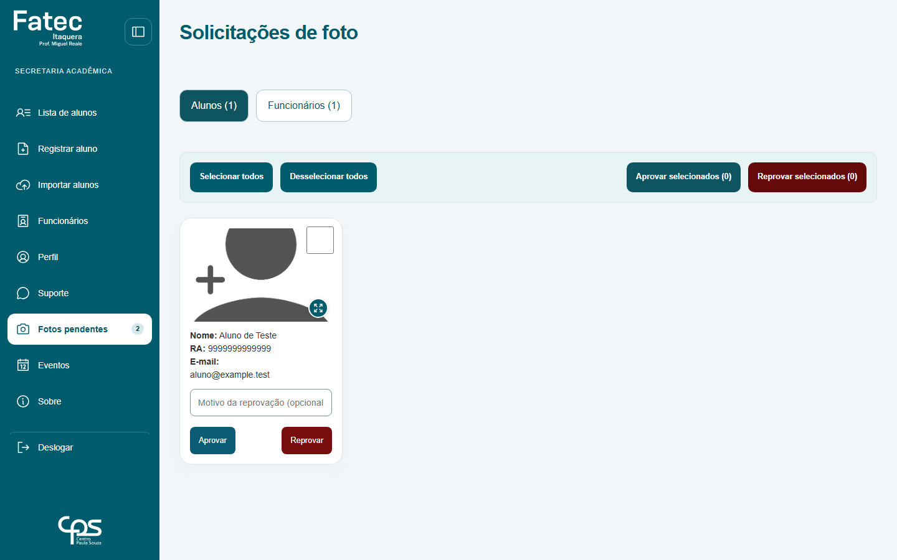
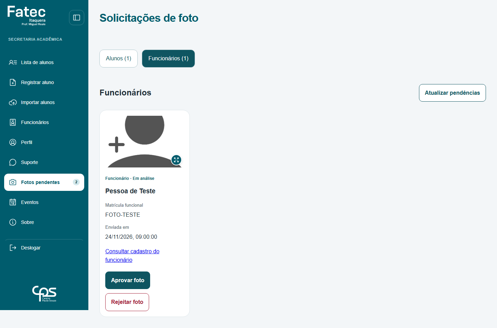
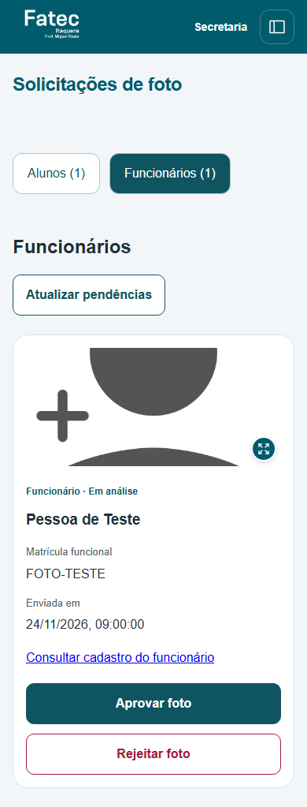
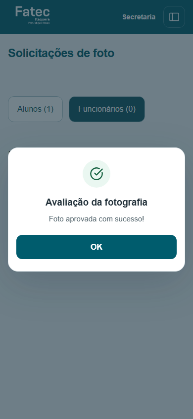
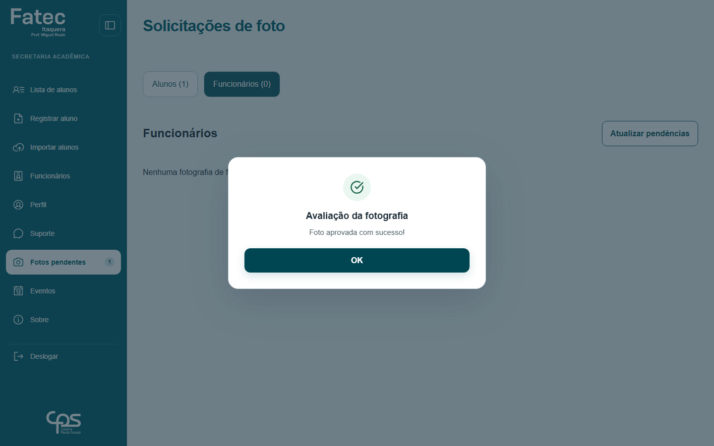

# Relatório — Home, carteirinha e fotografias

24/11/2026 — America/Sao_Paulo. Entrega em Draft, aguardando validação do responsável. Sem merge ou deploy de produção.

## GitHub

- Portal: issue #8, branch feature/issue-8-home-cache-carteirinha, PR Draft #9.
- Secretaria: issue #86, branch feature/issue-86-previa-fotos-modais, PR Draft #87.
- Base do Portal: b6d68b8efacd64ae4deeb23b201c6fc9bc1ebccc, já contendo o merge do PR #7.
- Base da Secretaria: 4d53462331a33255564c8a50da08692ed71b607e, já contendo o merge do PR #85.
- Backend de referência: ad6d27124329875acc6e7d6ded356d9064305820. Aluno de referência: 880745a1401615592dd9561d671fb5783b3db011. Ambos somente consultados.

## Diagnóstico e solução

A proteção de sessão e a Home consultavam o perfil separadamente. A navegação desmontava a tela e seus estados locais; useResource descartava a apresentação durante recarga/erro, e usePhotoUrl abortava e revogava o blob ao desmontar. Não havia deduplicação ou memória compartilhada. O nome genérico e a fotografia reaparecendo não dependiam de uma animação: faltava preservar os recursos reais já obtidos.

O cache em memória da sessão conserva perfil, situação e blobs privados. Perfil/foto são considerados recentes por 15 s, com revalidação em foco, visibilidade e a cada 30 s nas telas montadas. Consultas simultâneas usam a mesma promessa. A recarga mantém dados anteriores, apresentando erros sem apagá-los. Primeiro acesso não apresenta Funcionário como se fosse o nome real. Não foi adicionada dependência de consultas porque o projeto não utilizava TanStack Query.

O logout e a mudança de identidade abortam pedidos, limpam dados e fechamentos em memória e revogam blobs. Épocas e AbortSignal impedem respostas antigas de repor informações. Upload/remoção invalidam perfil, foto e carteirinha. Blobs que deixam de ser aprovados/pendentes são descartados. Carteirinha, verificação pública e suporte exigem leitura nova após desmontar a rota. Erros na consulta da credencial não liberam QR antigo.

O aviso usa a última tentativa rejeitada, sem substituir motivos ausentes por textos inventados. Uma pendência nova tem precedência sobre rejeições anteriores. A mensagem sobre foto aprovada anterior aparece somente se a API retorna essa fotografia. X fecha o aviso por photoId/reviewedAt na sessão; outra rejeição volta a aparecer. As cores, bordas, ícones e espaçamentos usam o padrão do aviso de aluno e os estilos institucionais existentes.

A carteirinha mantém cabeçalho e paleta. NOME:, UNIDADE: e FUNÇÃO: e seus valores passam a usar maiúsculas de apresentação; várias funções têm linhas próprias e textos podem quebrar naturalmente. Espaços verticais e alinhamento foram compactados. A fotografia é contida sem distorção/corte na frente. Frente/Verso usa dois botões de estado aria-pressed, com foco visível e teclado. Conteúdo do verso, dados e elegibilidade continuam fornecidos pelo backend.

Na Secretaria, uma coluna única deixava o card de funcionários ocupar toda a largura por causa de auto-fit. A grade passa a usar auto-fill com o mesmo mínimo de 240 px dos alunos e padding equivalente. A imagem continua no componente já utilizado pelos alunos, com prévia de 150 px de altura, mesma largura de card e ampliação autenticada. O componente e o fluxo de alunos não foram alterados.

A avaliação reutiliza MessageModal para Foto aprovada com sucesso! e Foto reprovada com sucesso!, com OK. A resposta precisa confirmar identidade, versão e resumo da foto. HTTP inválido, sessão expirada, 409, falha de conexão e JSON incompleto não exibem sucesso. A avaliação concluída sai da fila e as contagens são consultadas novamente; enquanto isso, o indicador informa atualização. O foco volta para Atualizar pendências após fechar o modal e terminar a recarga.

## Evidência de desempenho

Mesma conta fictícia, uma amostra por largura, API simulada com 150 ms por chamada. A contagem da entrada considera somente GET /funcionarios/me e GET /funcionarios/me/foto. O retorno considera somente perfil, situação e bytes da foto. A consulta de solicitações não lidas continua independente e não está incluída nesses números.

| Largura | Entrada perfil/foto | Retorno perfil/foto/blob | Home → Meus dados → Home |
|---|---:|---:|---:|
| 390 px | 3 → 2 | 4 → 0 | 492 → 145 ms |
| 1440 px | 3 → 2 | 4 → 0 | 552 → 124 ms |

Os tempos incluem ações e renderização local até nome/foto disponíveis. São medidas do cenário controlado, não medições de produção, Render ou redes reais. Os JSONs registram as amostras. O ganho estrutural comprovado é a retirada da consulta duplicada do guard e a reutilização dos dados no retorno recente.

## Testes e resultados

- Build TypeScript e Vite de ambos os projetos aprovados.
- Lint de todos os arquivos modificados: 0 erros, 0 avisos, nos dois projetos.
- Lint global do Portal: 0 erros, 0 avisos.
- Lint global da Secretaria: seis erros anteriores, fora dos arquivos alterados. DatePickerComp:74; PhotosScreen:69 e :75; UploadStudentsScreen:25 e :213; decodeToken:1. Nenhuma regra desativada.
- Cache: 9/9 testes Node aprovados. Deduplicação; TTL; dados preservados em erro; descarte de resposta tardia; limpeza e isolamento; invalidação seletiva; fechamentos por ocorrência; remoção de blobs; leitura nova de credenciais ao remontar.
- Secretaria: execução completa com 387/387 casos aprovados em 63 arquivos. Após o refinamento de foco/contagem, os cinco arquivos afetados foram revalidados em 32/32 casos, preservando as outras suítes aprovadas.
- Portal: regressão Playwright existente aprovada em 390×844, 768×1024 e 1440×900.
- Portal UX: cenários aprovados em 390×844 e 1440×900. A rodada de 390 passou; o cenário de desktop foi revalidado após delimitar uma asserção à rota correta. Os ajustes necessários ficaram nos seletores/sincronização do teste, sem afrouxar as verificações de comportamento.
- Portal UX verifica Home → Meus dados → Home, Home → Foto → Home, Home → Carteirinha → Home, ausência de substituição do nome/foto observando atualizações do DOM, API lenta/indisponível, nova rejeição, motivo, fechamento persistente na navegação, foto anterior, aprovação, pendência sem QR, foco/teclado, campos maiúsculos, múltiplas funções, logout, troca de pessoa e 401.
- Secretaria Playwright: prévias de alunos e funcionários medidas com mesma altura e largura equivalente; ampliação; aprovação/rejeição; motivo obrigatório; sucesso/OK; 409; resposta inválida; conexão indisponível; sessão expirada; contagens; celular e desktop. Ambos aprovados.

## Evidências e execução

Foram produzidas 20 capturas em celular e desktop. As imagens principais acompanham os PRs em docs/evidencias/ux-home-fotos. A galeria local contém todas. Consulte docs/UX_HOME_FOTOS.md para comandos do VS Code, variáveis e reprodução dos testes.

No ambiente desta execução os atalhos de node_modules/.bin estavam ausentes. Foram usados os entrypoints equivalentes via node para TypeScript, Vite e ESLint, sem alterar dependências. Uma instalação normal com npm ci permite os scripts npm documentados. A permissão de rede de testes foi necessária porque o sandbox inicialmente bloqueava até localhost. Os testes de navegador bloquearam destinos externos e usaram exclusivamente fixtures.

## Limitações e pendências

Não há homologação de produção, armazenamento, e-mail ou latência real do backend nesta etapa. O QR dos testes é uma fixture e o produto continua consumindo o QR retornado pela API; não foi criado identificador fictício na implementação. As regras de backend não foram alteradas.

A revalidação tem uma janela de atualização e depende de resposta da API; a memória da sessão não é uma cópia permanente nem substitui o backend como autoridade. Uma recarga completa da página reinicia esse cache. O fechamento do aviso de rejeição vale durante a sessão, conforme a estratégia escolhida. Os seis erros globais antigos de lint da Secretaria permanecem uma pendência separada. A validação visual e funcional final permanece com o responsável, e as issues continuam abertas.

## Capturas principais

## Arquivos modificados

funcionarios
- docs/RELATORIO_UX_HOME_FOTOS.md
- docs/UX_HOME_FOTOS.md
- docs/evidencias/ux-home-fotos/carteirinha-frente-1440.png
- docs/evidencias/ux-home-fotos/carteirinha-frente-390.png
- docs/evidencias/ux-home-fotos/carteirinha-verso-1440.png
- docs/evidencias/ux-home-fotos/carteirinha-verso-390.png
- docs/evidencias/ux-home-fotos/home-rejeicao-1440.png
- docs/evidencias/ux-home-fotos/home-rejeicao-390.png
- docs/evidencias/ux-home-fotos/metricas-comparacao.json
- package.json
- src/hooks.ts
- src/resourceCache.ts
- src/ui/components/photoStatus/PhotoStatus.tsx
- src/ui/components/studentPhoto/StudentPhoto.tsx
- src/ui/screens/credential/CredentialScreens.tsx
- src/ui/screens/credential/card.module.css
- src/ui/screens/mainmenu/MainMenuScreen.tsx
- src/ui/screens/uploadimage/PhotoScreen.tsx
- tests/cache.test.mjs
- tests/ux.browser.mjs

secretaria
- docs/RELATORIO_UX_HOME_FOTOS.md
- docs/UX_HOME_FOTOS.md
- docs/evidencias/ux-home-fotos/secretaria-alunos-1440.png
- docs/evidencias/ux-home-fotos/secretaria-funcionarios-1440.png
- docs/evidencias/ux-home-fotos/secretaria-funcionarios-390.png
- docs/evidencias/ux-home-fotos/secretaria-sucesso-aprovacao-1440.png
- docs/evidencias/ux-home-fotos/secretaria-sucesso-aprovacao-390.png
- docs/evidencias/ux-home-fotos/secretaria-sucesso-rejeicao-1440.png
- docs/evidencias/ux-home-fotos/secretaria-sucesso-rejeicao-390.png
- package.json
- src/api/employee/employeePhotos.test.ts
- src/api/employee/employeePhotos.ts
- src/screens/secretary/photos/EmployeePhotoQueue.test.tsx
- src/screens/secretary/photos/EmployeePhotoQueue.tsx
- src/screens/secretary/photos/employeePhotos.module.css
- tests/photos.browser.mjs

