# Lista de funcionários, importação e suporte — issue #90

Base: Secretaria main 93bd6047beaa3b7b4d37bec862bacdd684f97647. Contratos consultados no backend main fe2ac8f494314cf1b57340f3d55e52425c70aa48. Trabalho restrito ao frontend de Secretaria. Sem merge, deploy de produção, migração ou uso de dados reais.

## Comparação visual e comportamento

A listagem usa diretamente o container, barra de filtros e campo de pesquisa de ListStudentScreen, o TitleComp e o CSS da TabelaStudents: cabeçalho, células, espaçamentos, bordas, cores, badges, ícone de consulta e rolagem horizontal. As colunas específicas são foto, matrícula, situação, funções, nome, e-mail e consulta. O avatar mantém 40 × 40 px e object-fit: cover. O placeholder institucional ocupa a mesma área. As ações adicionais se acomodam em linhas no mobile.

A busca continua sendo submetida por nome, e-mail ou matrícula; Mostrar arquivados preserva a consulta e reinicia a paginação. A lista anterior permanece durante consultas e erros, identificada como última consulta; o cursor antigo não pode avançar sob um filtro novo. As regras de cadastro, edição, funções, arquivo/restauração e versões permanecem nos serviços e telas existentes.

Nos detalhes, a foto aprovada fica junto do nome, com 96 × 96 px, placeholder, nova tentativa após erro e ampliação no Modal existente. A consulta continua separada da edição.

## Fotografias privadas

EmployeeListItemView e EmployeeProfileView já fornecem photo.approvedPhotoId. Não há dependência de alteração no backend. O componente baixa somente esse identificador por GET /funcionarios/:id/fotos/:photoId/conteudo, usando getEmployeePhotoBlob e privateFetch existentes: autenticação Bearer, no-store, AbortController, validação de MIME e proteção de contexto de sessão. Somente URLs Blob temporárias aparecem na imagem; são revogadas na troca de identidade/foto/sessão e desmontagem. Não se utiliza pendingPhotoId, contentUrl nem URL pública de armazenamento. Uma foto anteriormente aprovada pode continuar visível durante a análise da substituta, conforme o contrato. Falhas individuais não bloqueiam a tabela.

## Importação

A rota protegida /funcionarios/importar reutiliza o estilo da importação de alunos. A entrada de arquivo e o botão estão nativamente desabilitados, sem accept, processamento, esquema, modelo para download ou chamada de importação. A mensagem informa que o modelo oficial ainda será definido. A implementação real aguarda a planilha oficial e uma etapa separada de contrato, validação, prévia, duplicidades e resultados.

## Suporte

Filtro inicial OPEN (Em aberto). Estados reais: OPEN — Em aberto; IN_PROGRESS — Em atendimento; WAITING_STUDENT — Aguardando aluno; RESOLVED — Resolvido; CLOSED — Encerrado. Todos é representado apenas na navegação por status vazio; o parâmetro é removido da chamada HTTP, sem estado fictício ALL. Alterações do select aplicam imediatamente e reiniciam o cursor. Filtros inválidos recaem em OPEN. A fila conserva a ordenação real do backend por createdAt asc e id asc, atendimentos mais antigos primeiro. Contadores globais não passam a representar o filtro. Respostas atrasadas de paginação são descartadas, e resultados de outro filtro não são mostrados como atuais após erro. Voltar do detalhe conserva a consulta e solicita dados novos; um chamado resolvido deixa a fila OPEN.

## Limites da validação

Testes de componentes e Playwright usam exclusivamente fixtures fictícias e API simulada. Não constituem homologação com serviços ou dados reais. O teste HTTP real existente é de eventos, fora deste escopo, e exige credenciais e ambiente específico; não foi executado. A aprovação visual e funcional desta entrega continua pendente do usuário.

O lint global apresenta seis erros preexistentes: DatePickerComp (1), PhotosScreen (2), UploadStudentsScreen (2), decodeToken (1). Não foram ocultados nem corrigidos fora de escopo. O build informa chunk grande e base Browserslist antiga; não impedem a geração.

## Executar e validar no VS Code

Clone o repositório e abra a branch feature/issue-90-melhorias-funcionarios-suporte no VS Code. Execute npm ci, configure VITE_BASE_URL para uma API local de desenvolvimento e execute npm run dev. Não use produção para testes de escrita. Execute npm test e npm run build.

Para Playwright, utilize uma instalação local de playwright e seu Chromium; EMPLOYEE_PORTAL_DIR aponta para o diretório com package.json, playwright instalado e public/perfil_default.png (mesmo padrão dos testes de navegador já existentes). Configure PLAYWRIGHT_BROWSERS_PATH se necessário. No PowerShell: $env:VITE_BASE_URL='http://localhost:3099'; npm run build; $env:EMPLOYEE_PORTAL_DIR='../carteirinha-digital-front-end-funcionarios'; npm run test:employees-list-support. O script sobe o preview na porta 4310, intercepta todas as chamadas de API e bloqueia origens externas. UX_EVIDENCE_DIR define a pasta das capturas. Não é necessário backend real.

Valide lista e detalhe em desktop/mobile, busca, Mostrar arquivados, fotos e placeholders, importação desabilitada e cada filtro de suporte. As ações administrativas e suporte têm cobertura existente e adicional de componentes, incluindo conflitos, rascunhos e resolução.

## Arquivos alterados

- package.json
- src/App.tsx
- src/api/employee/employeePhotos.ts
- src/api/employee/employeeService.ts
- src/screens/employees/EmployeeApprovedPhoto.test.tsx
- src/screens/employees/EmployeeApprovedPhoto.tsx
- src/screens/employees/EmployeeDetail.tsx
- src/screens/employees/EmployeeImport.test.tsx
- src/screens/employees/EmployeeImport.tsx
- src/screens/employees/EmployeesLayout.tsx
- src/screens/employees/EmployeesList.test.tsx
- src/screens/employees/EmployeesList.tsx
- src/screens/employees/employeeImport.module.css
- src/screens/employees/employeeList.module.css
- src/screens/employees/employeePhoto.module.css
- src/screens/employees/employees.module.css
- src/screens/support/SupportFilters.test.tsx
- src/screens/support/SupportScreen.test.tsx
- src/screens/support/SupportScreen.tsx
- src/screens/support/support.css
- tests/employees-list-support.browser.mjs

## Resultados dos testes

- TypeScript (tsc -b): aprovado.
- Build Vite/PWA: aprovado.
- Vitest: 419 testes aprovados em 68 arquivos (inclui 22 novos testes).
- Regressão direcionada de funcionários/suporte/fotografias: 27/27 aprovados.
- Novos testes e regressão de suporte: 31/31 aprovados.
- ESLint dos arquivos TypeScript alterados: zero erros e avisos.
- ESLint global: seis erros preexistentes, listados acima.
- Playwright: cenários com API simulada nas larguras 320, 390, 768 e 1440 px; capturas e comparação computada com a tabela de alunos documentadas no PR.

## Evidências visuais

Todas as capturas abaixo usam dados e imagem institucionais fictícios, com API interceptada. A comparação no Chromium confirmou igualdade de padding, cor e tamanho de fonte do cabeçalho e padding/tamanho de fonte das células em relação à tabela de alunos, nas quatro larguras. A tabela mantém sua rolagem horizontal interna.

### referencia-alunos

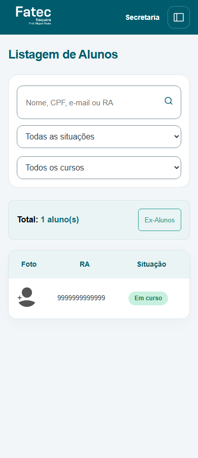

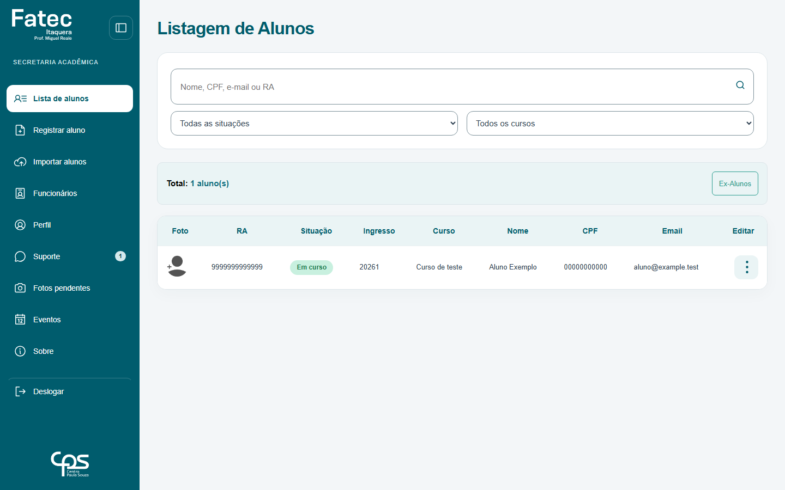

### lista-funcionarios

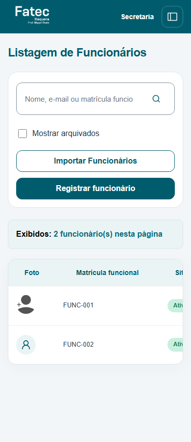

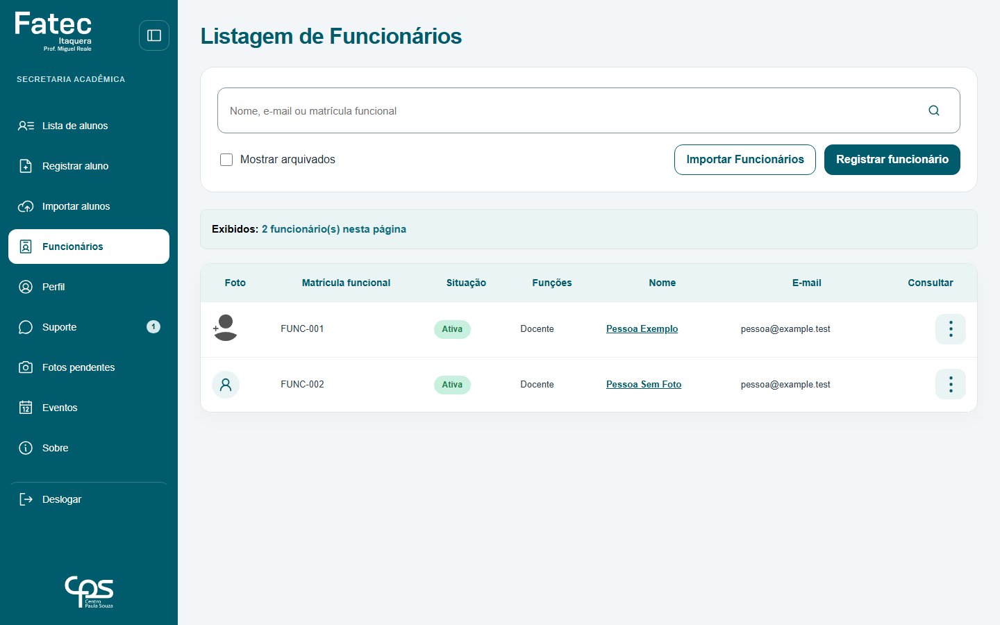

### foto-ampliada

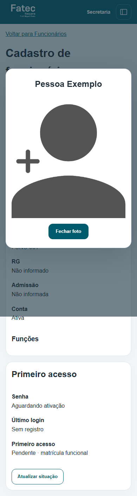

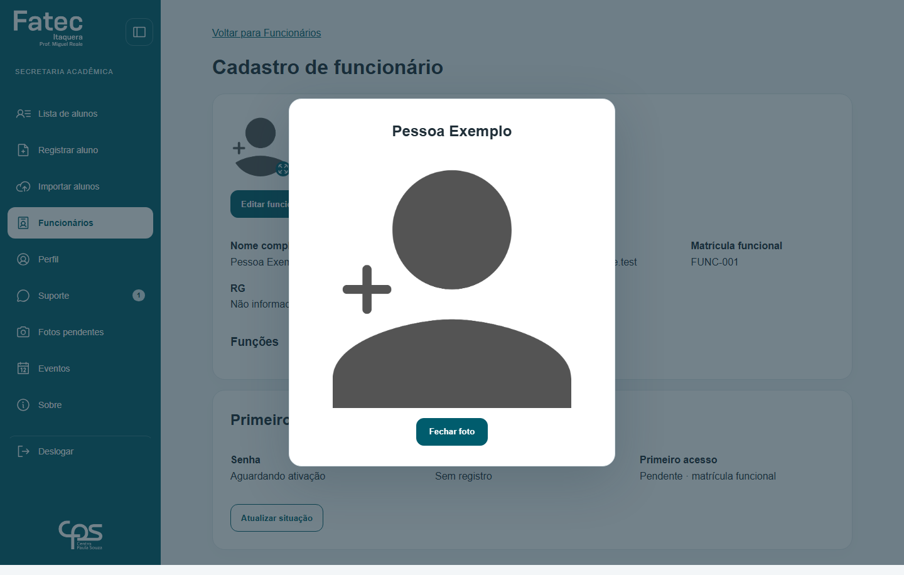

### importacao-preparacao

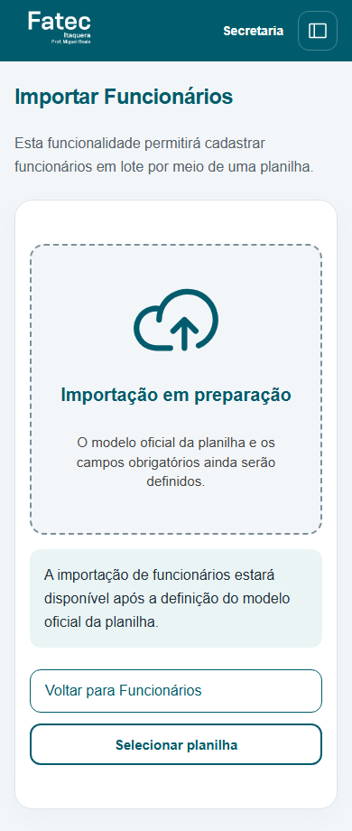

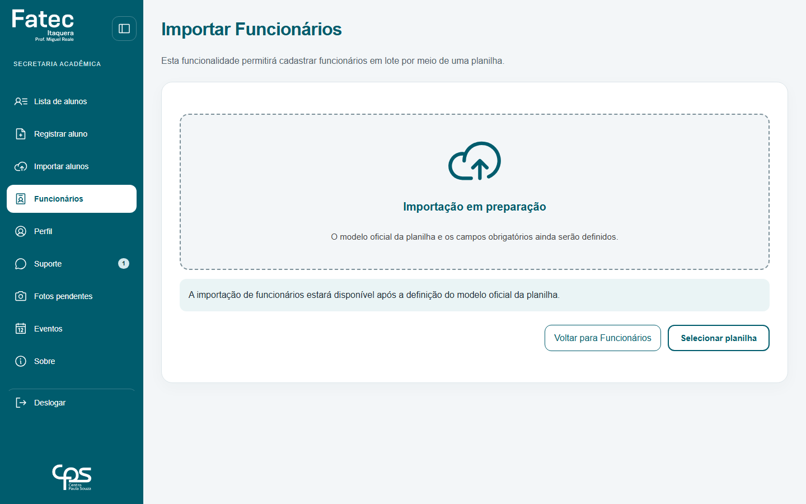

### suporte-em-aberto

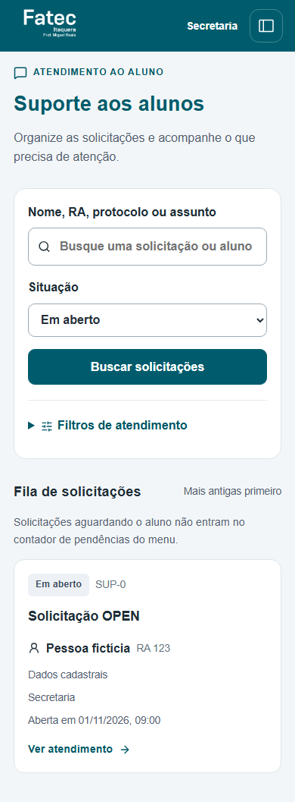

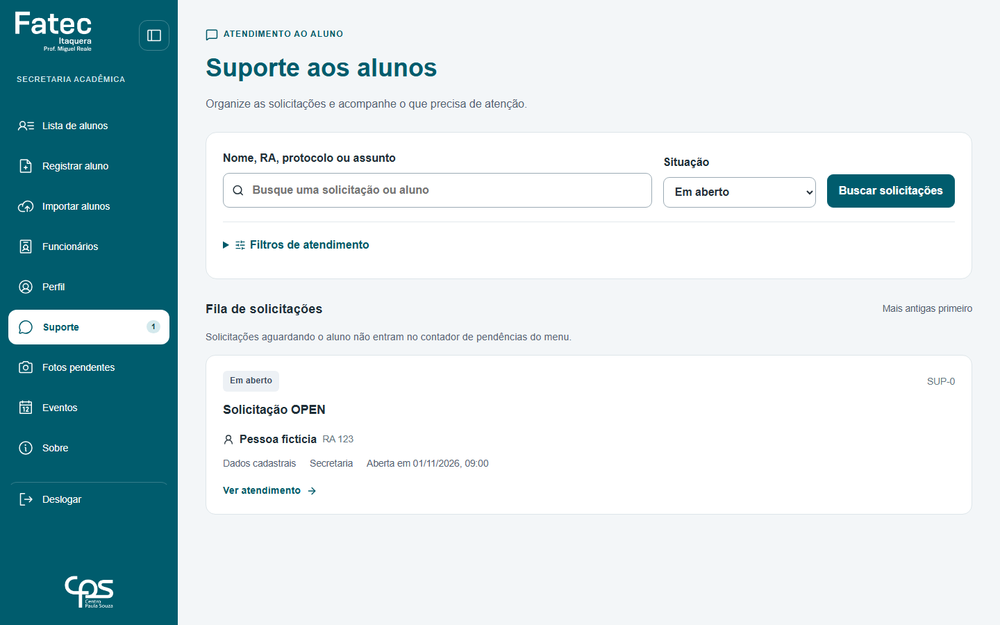

### suporte-todos

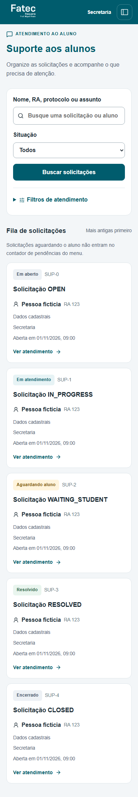

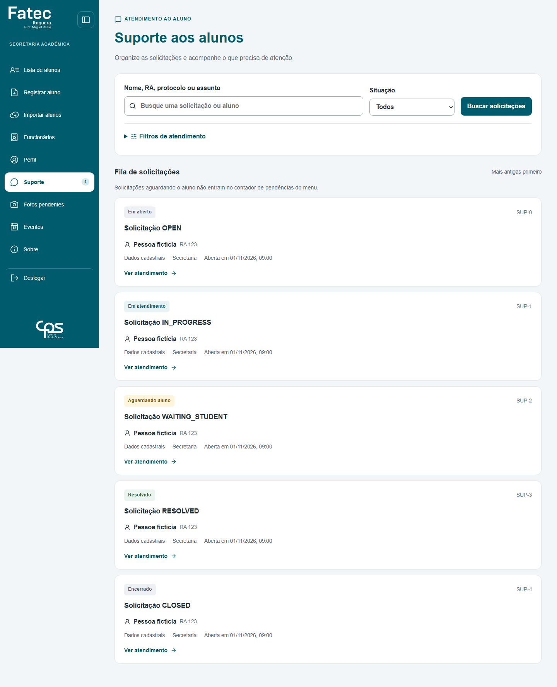

A regressão Playwright existente de fotografias passou em 390 e 1440 px: prévias de alunos e funcionários, ampliação, aprovação/rejeição, conflitos 409, resposta inválida, rede e sessão expirada, sempre com API simulada.

Lint restrito reproduzível: npx eslint src/api/employee src/screens/employees src/screens/support src/App.tsx. npm run lint continua apontando as seis falhas globais preexistentes.

A inspeção das capturas corrigiu o encaixe dos filtros em 320 px (grid com minmax(0,1fr)) e alinhou o botão de fechar da ampliação à paleta institucional. O build foi novamente gerado após esses ajustes de CSS; não houve nova alteração de lógica após os 419 testes.

### Comandos iniciais no terminal do VS Code

```powershell
git clone https://github.com/Carteirinha-Digital-Fatec-Itaquera/carteirinha-digital-front-end-secretaria.git
cd carteirinha-digital-front-end-secretaria
git switch feature/issue-90-melhorias-funcionarios-suporte
npm ci
$env:VITE_BASE_URL='http://localhost:3000'
npm run dev
```

Use a API local apenas com contas fictícias. Para os cenários isolados de navegador, substitua VITE_BASE_URL por http://localhost:3099 antes do build, conforme explicado acima. O servidor simulado fica dentro do Playwright; nenhuma porta de API precisa ser iniciada manualmente.
